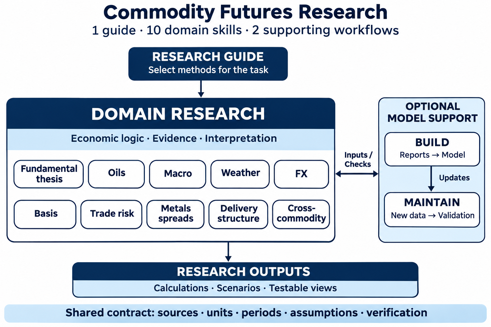

# Commodity Futures Research Skills

[简体中文](README.md) | **English**

An AI skill library for commodity futures research: analyze industry fundamentals, explain price drivers, evaluate basis and spreads, assess trade and hedging risks, and develop evidence-based, testable research views.

## Research capabilities

The library contains **1 research guide, 10 domain skills, and 2 balance-sheet workflows**. Domain skills provide research methods and industry definitions. Balance-sheet construction and maintenance support tasks that require modeling and form one subset of the library.

| Skill | Purpose |
|---|---|
| [Research guide](skills/commodity-research-guide/SKILL.md) | Method selection, terminology, and cross-topic coordination |
| [Fundamental thesis](skills/commodity-fundamental-thesis/SKILL.md) | Fundamentals, inventories, profits, and falsifiable theses |
| [Oils](skills/commodity-oils/SKILL.md) | Soybean, palm, and rapeseed oil fundamentals and physical markets |
| [Macro](skills/commodity-macro/SKILL.md) | Macro and policy transmission to commodity demand and costs |
| [Weather](skills/commodity-weather/SKILL.md) | Weather effects on production, logistics, and timing |
| [FX](skills/commodity-fx/SKILL.md) | Currency drivers, payment exposures, and hedging costs |
| [Basis](skills/commodity-basis/SKILL.md) | Physical pricing, basis trades, and combined physical–futures P&L |
| [Metals spreads](skills/commodity-metals-spread/SKILL.md) | Metals calendar spreads, carry costs, and import parity |
| [Delivery structure](skills/commodity-delivery-structure/SKILL.md) | Warehouse receipts, deliverable supply, and contract structure |
| [Cross-commodity](skills/commodity-cross-commodity/SKILL.md) | Relative value, processing margins, co-products, and substitution |
| [Trade risk](skills/commodity-trade-risk/SKILL.md) | Performance, credit, ownership, settlement, and funding risk |
| [Balance-sheet build](skills/commodity-balance-sheet-build/SKILL.md) | Build a supply–demand model from reports, historical data, and assumptions |
| [Balance-sheet maintain](skills/commodity-balance-sheet-maintain/SKILL.md) | Update existing balances and verify periods, capacity, and formula dependencies |

## How the skills work together

Select the lead skill for the research question and add supporting skills as needed. Domain skills supply economic logic and interpretation. When modeling is required, use Build or Maintain and pass along variables, units, periods, sources, and assumptions.



Build / Maintain represent only the balance-sheet workflows. Macro, basis, spread, delivery, and risk research can run independently without a balance sheet. Arrows indicate task handoffs, not automatic multi-agent execution.

## Use

Copy the required folders from `skills/` into your agent’s skill directory, keeping each `SKILL.md`, its references, and any `agents/` metadata together. Review existing installations before replacing them. Skill instructions are primarily in Chinese.

**Example requests**

```text
Use $commodity-fundamental-thesis to explain the divergence between
inventories and profits. Separate facts from assumptions and state
what would invalidate the thesis.
```

```text
Use $commodity-cross-commodity to compare PTA and ethylene glycol,
checking each market’s supply, inventories, and shared downstream demand.
```

Each skill retains its source references. Keep facts, forecast assumptions, and missing data distinct. Respect the user’s file-editing scope and obtain consent before creating files or worksheets.

`skills/BUILD_MANIFEST.json` records the original 11 research skills; the two balance-sheet workflows are later additions.
