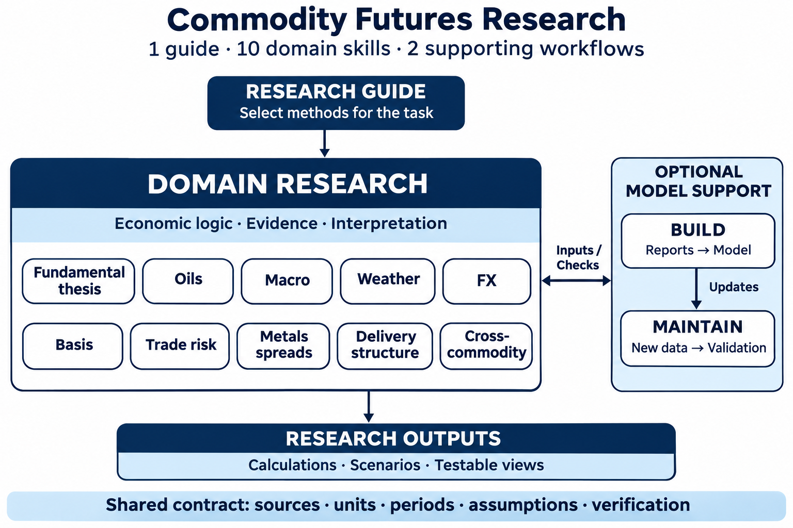

# 大宗商品期货研究 Skill 库

**简体中文** | [English](README.en.md)

面向 AI 助手的大宗商品期货研究工具库，用于梳理产业供需、解释价格驱动、分析基差与价差、评估贸易及套保风险，并形成有依据、可验证的研究判断。

## 研究能力

全库包含 **1 个研究入口、10 个专业研究 Skill、2 个平衡表工作流**。专业研究组件提供分析方法与产业口径；平衡表搭建和维护服务于需要建模的任务，是整个研究库的一个子集。

| Skill | 用途 |
|---|---|
| [研究入口](skills/commodity-research-guide/SKILL.md) | 研究方法选择、术语查询与跨主题分工 |
| [基本面与研究观点](skills/commodity-fundamental-thesis/SKILL.md) | 产业供需、库存与利润分析，建立可证伪观点 |
| [油脂研究](skills/commodity-oils/SKILL.md) | 豆油、棕榈油、菜油产业链及现货研究 |
| [宏观研究](skills/commodity-macro/SKILL.md) | 宏观与政策向商品需求、成本的传导 |
| [天气影响](skills/commodity-weather/SKILL.md) | 天气对产量、物流及供需时点的影响 |
| [外汇研究](skills/commodity-fx/SKILL.md) | 汇率驱动、收付汇敞口与锁汇成本 |
| [基差与套保](skills/commodity-basis/SKILL.md) | 现货点价、基差交易与期现合并损益 |
| [有色价差](skills/commodity-metals-spread/SKILL.md) | 有色月差、持有成本与进口窗口 |
| [交割与期限结构](skills/commodity-delivery-structure/SKILL.md) | 仓单、可交割货源与期限结构 |
| [跨品种研究](skills/commodity-cross-commodity/SKILL.md) | 跨品种强弱、加工利润、伴生及替代关系 |
| [贸易风险](skills/commodity-trade-risk/SKILL.md) | 履约、信用、货权、结算与资金风险 |
| [平衡表搭建](skills/commodity-balance-sheet-build/SKILL.md) | 从报告整理历史数据与假设，搭建供需模型 |
| [平衡表维护](skills/commodity-balance-sheet-maintain/SKILL.md) | 更新已有平衡表，核对期间、产能与公式传导 |

## 组件协作

从研究问题选择主办 Skill，按需补充其他组件。专业 Skill 负责经济逻辑和结果解释；涉及建模时，再调用搭建或维护工作流，交接变量、单位、期间、来源和假设。



图中 Build / Maintain 仅代表平衡表工作流。宏观、基差、价差、交割和风险等研究可独立开展，无需经过平衡表；箭头表示任务交接，不表示自动启动多代理。

## 使用方式

将 `skills/` 下所需目录放入 AI 助手的 Skill 目录，保留各自的 `SKILL.md`、参考资料和已有的 `agents/` 元数据。替换已有安装前先核对内容。Skill 正文以中文为主。

**调用示例**

```text
使用 $commodity-fundamental-thesis，解释该品种库存与利润背离的原因，
区分事实与假设，并给出观点失效条件。
```

```text
使用 $commodity-cross-commodity，分析 PTA 与乙二醇的相对强弱，
分别核对供需、库存和共同下游需求。
```

各 Skill 保留来源依据；事实、预测假设与缺失数据分开处理。文件操作遵循用户授权，新增文件或工作表须先获同意。

`skills/BUILD_MANIFEST.json` 记录原始 11 个研究 Skill；两个平衡表工作流为后续扩展。
